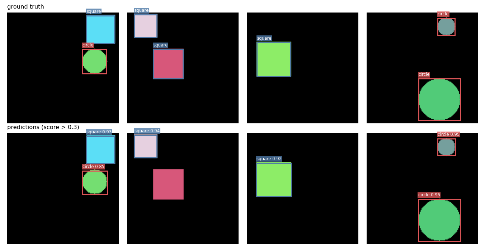
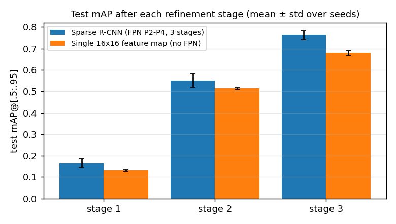
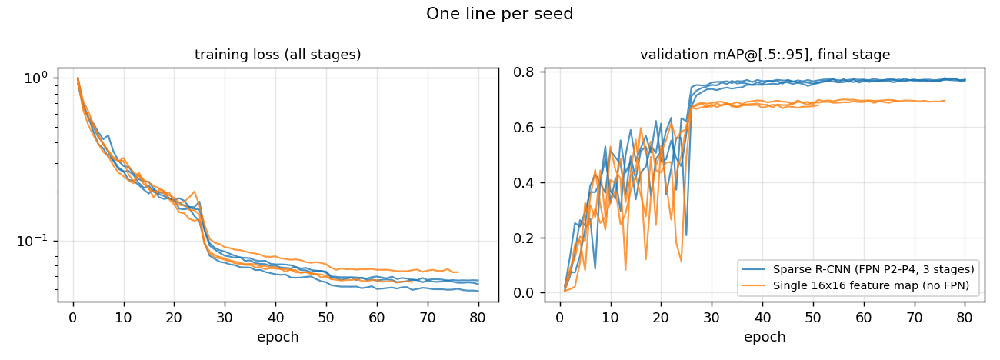
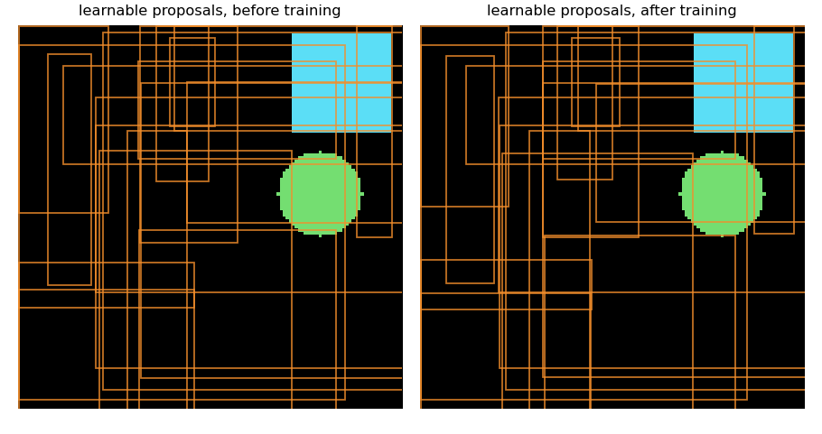
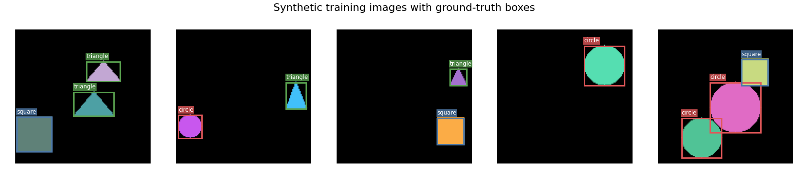

# Sparse R-CNN from Scratch on Synthetic Shapes

A compact PyTorch implementation of **Sparse R-CNN** (Sun et al., 2021): an end-to-end object detector with **20 learnable proposal boxes** instead of dense anchors, **dynamic instance interaction** heads, three-stage iterative box refinement and a Hungarian-matched set loss, so no NMS is needed. It is trained on a synthetic dataset of coloured circles, squares and triangles, so the whole experiment grid trains in about 35 minutes on a free Colab T4. Results are reported as COCO mAP on a separate 1,000-image test set, as mean ± std over 3 seeds, with the checkpoint chosen on a validation split.

**In short:** the detector reaches **0.762 ± 0.020 mAP@[.5:.95]** (0.898 mAP@.5). The FPN adds 8 mAP points over a single 16×16 feature map, almost all of it from tighter boxes. Iterative refinement does most of the work, taking mAP from 0.17 after stage 1 to 0.76 after stage 3. The "learnable" proposal boxes barely move during training.

## Results

Test-set metrics for the checkpoint chosen on validation mAP, as mean ± std over seeds 42, 43 and 44. The test set is 1,000 freshly generated images with 2,020 objects.

| Model | Params | Test mAP@[.5:.95] ↑ | mAP@.5 ↑ | mAP@.75 ↑ | AR@100 ↑ | AP circle / square / triangle | Exact object count ↑ | Selected epoch |
|---|---:|---:|---:|---:|---:|---:|---:|---:|
| Sparse R-CNN (FPN P2-P4, 3 stages) | 6.00M | **0.762 ± 0.020** | **0.898 ± 0.012** | **0.832 ± 0.020** | **0.846 ± 0.013** | 0.831 / 0.701 / 0.754 | 0.63 ± 0.03 | 77, 76, 76 |
| Single 16x16 feature map (no FPN) | 5.68M | 0.680 ± 0.011 | 0.887 ± 0.003 | 0.768 ± 0.013 | 0.773 ± 0.010 | 0.770 / 0.598 / 0.670 | 0.64 ± 0.03 | 31, 47, 56 |

"Exact object count" is the share of test images with exactly as many detections above score 0.3 as there are objects. Per-seed numbers, per-epoch curves and the proposal boxes are in [`results/metrics.json`](results/metrics.json), and the training log is in [`results/run_log.txt`](results/run_log.txt).







### Findings

1. **The FPN mostly buys localisation precision.** The multi-scale model beats the single 16×16 map by 8 mAP points (0.762 vs 0.680), and every seed of one beats every seed of the other. At the loose IoU 0.5 threshold the two are within noise (0.898 vs 0.887). The gap opens at IoU 0.75 (0.832 vs 0.768). At 16×16, one feature cell spans 8 pixels, which is coarse next to objects of 10–50 pixels. The 64×64 P2 map, where most of these small boxes are pooled, gives the box head enough detail to place edges precisely.
2. **Iterative refinement does most of the work.** On the same trained model, mAP is 0.17 after stage 1, 0.55 after stage 2 and 0.76 after stage 3, and the gain is still large at the last stage. Stage 1 starts from the proposal boxes, which are a fixed, image-independent set. Stage 2 is the first to see RoIs that were already moved towards the objects. A 4th or 5th stage, which the paper uses (6 stages), would likely help further.
3. **The learnable proposal boxes hardly learn.** Across all runs, the 20 proposal boxes moved on average 0.5 px, and at most 4 px, from their random initialisation (see the figure below). Two things explain this. Each proposal is matched to different objects in different images, so its gradients largely cancel. And on this dataset the objects are spread uniformly over the image, so there is no location pattern for the proposals to learn. The paper reports that proposals learn the location statistics of COCO; with uniform synthetic data they act as fixed reference boxes, and the dynamic heads do the localising.
4. **"No NMS needed" holds only partly at this scale.** With a fixed score threshold of 0.3, only 63% of test images get exactly as many detections as objects. Another 18% get duplicates or false positives, and 19% miss an object, like the unboxed red square in the second image above. The one-to-one matching discourages duplicates, but with no self-attention between proposals (a component of the full model that this version leaves out), the proposals cannot coordinate.
5. **Most of the learning happens at the learning-rate drop.** Validation mAP swings between 0.1 and 0.6 for the first 25 epochs. When the learning rate drops 10× at epoch 25, it jumps to about 0.75 and stays flat. After that, the selected checkpoint and the last epoch give the same test mAP (0.762 vs 0.763). A warm-up plus cosine schedule, or simply a lower learning rate, would probably reach the plateau sooner.

**Caveats.** Squares are the hardest class (AP 0.70, vs 0.83 for circles). This was not analysed further; one candidate is the 10 px minimum side, which makes squares the smallest objects. The data is deliberately simple, so these numbers say nothing about real images. The original course report gave mAP 0.707 from one run on 100 test images, computed after dropping detections with score ≤ 0.3. The same thresholded metric here is 0.713 ± 0.026, but the dataset generator also changed (see below), so the two are not strictly comparable.



## Model

```
image 3×128×128
  └─ backbone: 3 × (Conv3×3 ─ BN ─ ReLU ─ MaxPool)  → C2 32×64×64, C3 64×32×32, C4 128×16×16
     └─ FPN (top-down + lateral 1×1, smooth 3×3)     → P2 64×64, P3 32×32, P4 16×16, 128 channels each

20 learnable proposal boxes (cx, cy, w, h) + 20 learnable 128-d proposal features
  └─ repeat for 3 stages:
       RoIAlign 7×7 from P2/P3/P4 (chosen by box area)
       dynamic interaction: each proposal feature generates the weights of two 1×1 convs
                            (128→32→128) applied to its own RoI, then Linear(7·7·128 → 128)
       class head  Linear(128 → 4)    circle / square / triangle / background
       box head    Linear(128 → 4)    Δcx·w, Δcy·h, w·e^Δw, h·e^Δh  → refined boxes for the next stage
```

**Training objective.** At every stage, the 20 predictions are matched one-to-one to the ground-truth objects with the Hungarian algorithm (`scipy.optimize.linear_sum_assignment`). The matching cost is −p(class) + L1 box distance. The loss is a multi-class focal loss (γ = 2) over all proposals, plus 2 × L1 box loss on matched proposals, summed over the three stages. Unmatched proposals are trained towards "background", which is why the detector needs no NMS.

The model is in [`src/model.py`](src/model.py) and the matcher and loss in [`src/losses.py`](src/losses.py).

## Data

The data is generated on the fly by [`src/data.py`](src/data.py), so nothing is downloaded or committed.

| | |
|---|---|
| Images | 128×128, black background, 1–3 shapes, each with a random colour (every channel at least 64) |
| Shapes | circle (radius 10–24 px), square (side 10–39 px), isosceles triangle (15–39 × 15–39 px) |
| Constraints | IoU between any two boxes at most 0.1; every shape stays at least 75% unoccluded |
| Train / validation | 900 / 100 images from one seed (assignment split) |
| Test | 1,000 images from a separate seed, used only for the final metrics |



## Evaluation

| Metric | Details |
|---|---|
| **mAP@[.5:.95]** | COCO-style mean AP over IoU 0.50:0.05:0.95 (torchmetrics / pycocotools), using all 20 detections per image ranked by score. |
| mAP@.5, mAP@.75, AR@100 | The same evaluation at single IoU thresholds, and average recall. |
| Per-stage mAP | mAP of the boxes after stage 1, 2 and 3 of the same model, which shows what iterative refinement buys. |
| Exact object count | Share of test images with exactly as many detections above score 0.3 as there are objects. This checks the NMS-free claim: duplicates count as over, misses as under. |

## Training setup

| | |
|---|---|
| Optimiser | Adam, lr 5·10⁻⁵ (as in the assignment), ×0.1 every 25 epochs, gradient clipping at 10 |
| Batch size | 16 |
| Epochs | up to 80; early stopping with patience 20 on validation mAP |
| Checkpoint | highest validation mAP@[.5:.95] (the test set is never used for selection) |
| Seeds | 42, 43, 44 (model initialisation and batch order; the dataset is fixed) |

## Reproduce

```bash
pip install -r requirements.txt
python src/run_experiments.py                    # sparse_rcnn + single_scale, 3 seeds each (GPU recommended)
python src/run_experiments.py --only more_data   # optional: 4,900 training images
python src/run_experiments.py --smoke            # 1 seed, 2 tiny epochs: a quick CPU check
```

No GPU? Open [`colab_run.ipynb`](colab_run.ipynb) in Google Colab with a T4 runtime.

Outputs go to `results/`: `metrics.json` (every run, with per-epoch history, test metrics and proposal boxes), `results_table.md` and `figures/`. Checkpoints go to `results/checkpoints/`, which is git-ignored.

```
src/
  config.py           dataset, model, loss and training settings (dataclasses), experiment list
  data.py             synthetic shape generator, train/val/test split, Dataset and collate_fn
  model.py            backbone + FPN, learnable proposals, dynamic interaction, 3-stage head
  losses.py           Hungarian matcher, focal + L1 set loss with deep supervision
  metrics.py          COCO mAP per stage, thresholded mAP, detection-count check
  train.py            training loop, validation-mAP checkpoint selection, plots
  run_experiments.py  runs experiments × seeds, aggregates, writes results/
colab_run.ipynb       one-click GPU run on Google Colab
```

## Changes from the original course version

This repo is a cleaned-up rewrite of a course assignment. The main fixes:

- **RoI features and proposals could be misaligned.** RoIs were pooled per FPN level and concatenated level by level. In the working copy of the course code, the sort that restores proposal order was applied after the features were already stored, so a proposal could receive another proposal's features. RoIAlign is now done for all boxes at once and written back by mask, so the order is correct by construction. It is also no longer a Python loop over images.
- **No held-out evaluation.** The 100 test images were used as the per-epoch "validation" curve and for the final mAP, from one unseeded run. Now there is a 100-image validation split for checkpoint selection and a separate 1,000-image test set, over 3 seeds.
- **mAP was computed after dropping detections with score ≤ 0.3.** COCO mAP must rank all detections, so the threshold lowers recall at low precision and biases the number. Standard mAP is now the main metric, and the thresholded version is still recorded (`map_thr0.3` in `metrics.json`) for comparison.
- **Data generator.** The occlusion check tested the *new* shape, which is drawn last and is never occluded. It now checks that the earlier shapes stay visible. Colours are kept at least 64 per channel, so no labelled shape is invisible on the black background.
- Boxes are detached between refinement stages, as in the paper. The visualisation no longer assumes a CUDA device, the duplicate box-clamping helper and the leftover unused code were removed, and missing dependencies (`torchmetrics`, `pycocotools`, `opencv`) were added.

## Possible next steps

- Self-attention between proposal features before the dynamic interaction, as in the full Sparse R-CNN, so proposals can coordinate and suppress duplicates (finding 4).
- More refinement stages (the paper uses 6), since the third stage still adds 21 mAP points (finding 2).
- A schedule with warm-up and cosine decay instead of the 10× step at epoch 25 (finding 5).
- Non-uniform object placement, to test whether the proposal boxes then learn location statistics (finding 3).
- GIoU in the matching cost and the box loss (the paper uses L1 + GIoU).
- Harder data: more shapes per image, heavier occlusion, textured backgrounds and scale variation, to see where 20 proposals stop being enough.
- A Faster R-CNN baseline from torchvision on the same data, to compare against dense anchors with NMS.
